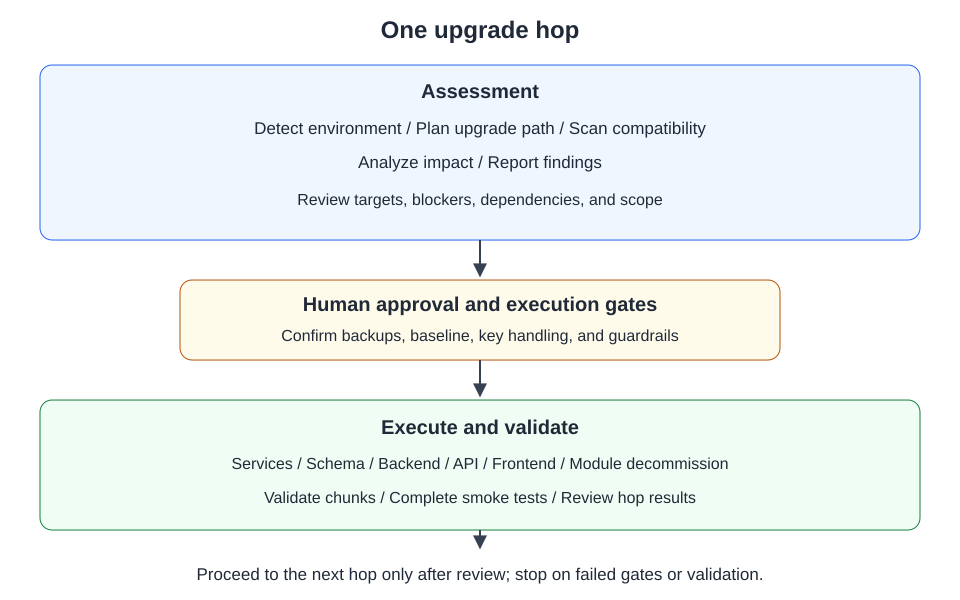

# Commerce Upgrade Toolkit

The Commerce Upgrade Toolkit (CCUA) is an AI-assisted toolkit for assessing and executing Adobe Commerce upgrades. It detects the development environment, proposes a multi-hop upgrade plan, scans version transitions for breaking changes, and coordinates fixes with your approval at execution gates.

You install the toolkit as an Adobe I/O CLI plugin and run it as slash commands in an AI agent session, either GitHub Copilot or Claude Code. Specialist agents in that session analyze findings, apply fixes, run validation, review security-sensitive changes, and generate reports. You review and approve each stage.

## When to use the toolkit

Use the toolkit to assess the work required to upgrade an existing Adobe Commerce development project and to execute the reviewed plan.

| Phase | Purpose | Output |
| --- | --- | --- |
| Assessment | Identify compatibility issues, service changes, and blockers before making upgrade changes. | An upgrade roadmap, findings, and an effort estimate. |
| Execution | Apply approved fixes in dependency order and validate each version transition. | Changes to the development project, validation results, and a hop result report. |

A *hop* is one version transition in the upgrade plan. Review each proposed target against the supported upgrade path and system requirements. Treat each approved hop as a separate upgrade and validation cycle.

The toolkit provides three slash commands:

| Command | Purpose |
| --- | --- |
| `/upgrade-hop` | Plan the upgrade, or analyze one hop when you specify a version. |
| `/upgrade-hop-execute` | Apply and validate the fixes for one hop. |
| `/upgrade-deploy-prep` | Prepare the deployment runbook after all hops are complete. |

For details, see [Usage](usage.md).

## Relationship to the Upgrade Compatibility Tool

The Commerce Upgrade Toolkit coordinates planning, analysis, and execution. It uses the [Upgrade Compatibility Tool](../upgrade-compatibility-tool/overview.md) to collect compatibility findings for individual target versions.

## Workflow

The diagram summarizes the workflow for an individual hop:

1. Detect the environment and prepare the development baseline.
1. Plan the upgrade path and review the proposed targets.
1. Scan the target version with the Upgrade Compatibility Tool.
1. Analyze code impact, dependencies, and blockers.
1. Generate a findings report and agree on the scope of work.
1. Confirm backups, the working-tree baseline, and other execution gates.
1. Apply fixes in dependency order, validating each chunk.
1. Complete deployment checks and smoke tests, then review the result report before starting the next hop.

After the final hop, `/upgrade-deploy-prep` produces a deployment runbook for you to review and run. The toolkit does not run deployment commands itself.

>[!IMPORTANT]
>
>Use the toolkit in a local development environment, not production. Human approval and review are required; a generated plan or report is not evidence of a successful upgrade or deployment approval.

## Get started

- [Install and configure the toolkit](installation.md).
- [Assess and execute an upgrade](usage.md).
- [Troubleshoot setup and execution](troubleshooting.md).
- [Review limitations and operational considerations](limitations.md).
