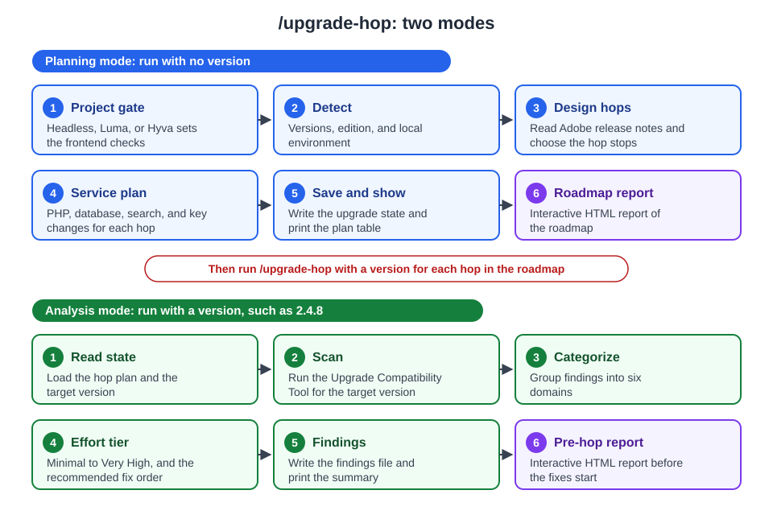

# Usage

Complete [installation and setup](installation.md) before starting. Run the toolkit slash commands in the configured AI agent session, not as shell commands. Replace `<target-version>` in the examples with a version from your reviewed roadmap.

## Assess the upgrade

The `/upgrade-hop` command has two modes. Without a version, it plans the whole upgrade. With a version, it analyzes one hop.



### Generate the roadmap

Run:

```text
/upgrade-hop
```

The toolkit detects the project environment and proposes a sequence of version transitions. Review the detected Adobe Commerce version, PHP version, environment, and proposed targets before approving the plan.

For each hop, the roadmap describes the required service changes, an effort tier (Minimal, Low, Medium, High, or Very High), and known blockers. The toolkit saves the plan to an upgrade state file in the project, which later commands read.

The planning stage researches release notes and breaking changes for the target versions and asks for your approval before proceeding.

### Analyze an individual hop

Specify a target version from your reviewed roadmap:

```text
/upgrade-hop <target-version>
```

The toolkit runs the Upgrade Compatibility Tool for that target and organizes the findings into the following domains:

| Domain | Examples |
| --- | --- |
| Backend | Deprecated classes, removed methods, and changed interfaces. |
| API contract | Breaking changes to REST or GraphQL contracts. |
| Schema | Required declarative schema changes. |
| Frontend | Deprecated JavaScript or CSS and changes to storefront components. |
| Services | Search engine migration and queue changes. |
| Module decommission | Removed modules or extensions that require a replacement or removal decision. |

Review the severity, blocker count, dependencies, and effort estimate for the hop. Agree on the scope and pacing before execution, for example blockers first, one representative fix per pattern, or all findings in one pass.

### Review the execution gates

For the same target, run:

```text
/upgrade-hop-execute <target-version>
```

The toolkit asks you to confirm each of the following before it changes anything:

- The `app/etc/env.php` file is backed up outside the project directory.
- A full database backup is taken.
- The Git working tree is clean. Commit or stash your changes first.
- The encryption-key rotation check is complete, when the hop requires a rotation.
- Deferred items from earlier hops are reconciled.

### Review and execute the chunk plan

The toolkit proposes dependency-ordered chunks:

```text
Services -> Schema -> Backend -> API contract -> Frontend -> Module decommission
```

Review the plan before approving changes. The Services chunk runs first. The toolkit then upgrades Adobe Commerce to the target version before it applies the remaining chunks, because the other fixes cannot be validated until the target version is installed. Infrastructure changes require your confirmation before dependent application work proceeds. The Frontend chunk does not apply to headless projects.

After each chunk, the toolkit runs the applicable validation, such as dependency injection compilation, PHPCS, and PHPUnit. If validation fails, the toolkit retries up to three times and then stops for your decision. Review failed checks and unresolved findings before continuing.

Core modifications and custom extensions without a safe upgrade path require a human decision. For large numbers of findings, the toolkit asks you to choose the scope and pacing of the work.

### Resume interrupted work

To resume from a specific chunk without rerunning the earlier chunks, run:

```text
/upgrade-hop-execute <target-version> --chunk=<number>
```

### Complete post-hop validation

Review and approve the deployment commands for your development environment. The post-hop checklist includes:

```shell
bin/magento setup:upgrade
bin/magento setup:di:compile
bin/magento setup:static-content:deploy -f
bin/magento cache:flush
bin/magento indexer:reindex
```

Run commands in the application runtime or container appropriate to your environment.

Complete and record smoke tests:

- Category and product pages render.
- Search returns expected results.
- Add-to-cart and checkout flows complete.
- The Admin is accessible and the orders grid loads.
- Cron runs without errors.
- Payment gateway credentials decrypt correctly in a test transaction.
- `var/log/exception.log` contains no unresolved critical upgrade errors.

For headless projects, run reviewed REST and GraphQL contract tests and retain the results. A generated test plan does not establish that tests passed.

Review the hop result report and resolve blockers before starting the next hop.

### Prepare for deployment

After every hop is complete and all deferred items are resolved, run:

```text
/upgrade-deploy-prep
```

The command checks that every hop is complete, runs the pre-deployment checks, and generates a deployment runbook report. It does not run deployment commands. You review the runbook and perform the deployment.

## Review reports

| Report | Review |
| --- | --- |
| Roadmap | Planned version transitions, service requirements, effort estimates, and dependencies. |
| Findings | Compatibility issues, severity, blockers, incompatible extensions, and decisions required for the current hop. |
| Hop result | Changes made, resolved and outstanding findings, validation evidence, and remaining work. |

Reports reflect the evidence available when they are generated. A roadmap is not a completion report, and a result report is not deployment approval. Share only reviewed reports that contain no secrets, credentials, or personal data.

## Command reference

| Command | Purpose |
| --- | --- |
| `/upgrade-hop` | Generate the proposed upgrade roadmap. |
| `/upgrade-hop <target-version>` | Analyze an individual target version. |
| `/upgrade-hop-execute <target-version>` | Execute the reviewed hop with approval gates. |
| `/upgrade-hop-execute <target-version> --chunk=<number>` | Resume at the chunk identified in the saved execution plan. |
| `/upgrade-deploy-prep` | Generate the deployment runbook after all hops are complete. |
